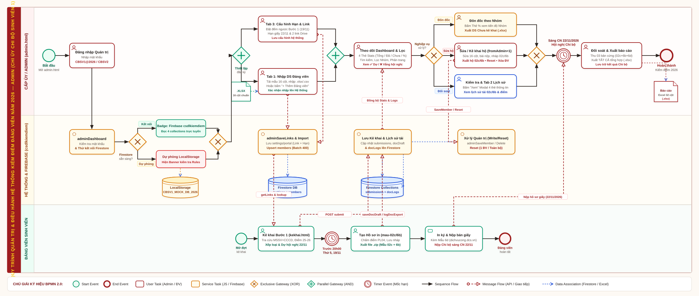
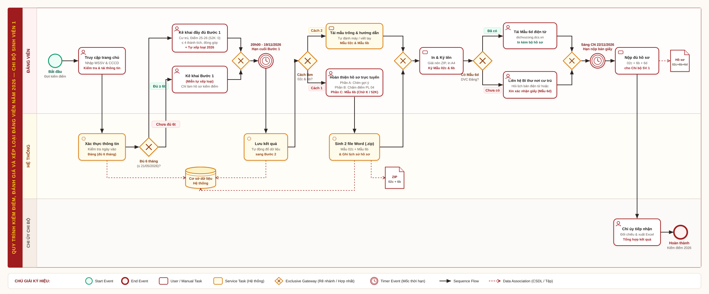

# HƯỚNG DẪN SỬ DỤNG CỔNG QUẢN TRỊ (ADMIN) & QUY TRÌNH BPMN 2.0 NĂM 2026
**Đơn vị:** Chi bộ Sinh viên 1  
**Trang Cổng Quản trị:** `admin.html` • **Trang Hướng dẫn & Sơ đồ tương tác:** `huong-dan-admin.html`  
**Địa chỉ hệ thống:** https://diendue48k.github.io/KIEMDIEM2026_CBSV1/admin.html

---

## PHẦN 1: SƠ ĐỒ QUY TRÌNH BPMN 2.0 QUẢN TRỊ & ĐIỀU HÀNH HỆ THỐNG

- **Ảnh vector BPMN 2.0 Quản trị (Admin):** 
- **File chuẩn OMG BPMN 2.0 XML:** [`quy-trinh-admin-2026.bpmn`](./quy-trinh-admin-2026.bpmn)
- **Sơ đồ BPMN 2.0 đối chiếu phía Đảng viên:** 

---

## PHẦN 2: ĐĂNG NHẬP, KIỂM TRA FIREBASE & 4 THẺ THỐNG KÊ TƯƠNG TÁC

### 2.1. Đăng nhập & Phiên làm việc
- Truy cập `admin.html` (hoặc bấm **Cổng quản trị** ở chân trang chủ `index.html`).
- Nhập mật khẩu quản trị (`CBSV1@2026` hoặc `CBSV2@2026`, không phân biệt chữ hoa/thường).
- Phiên đăng nhập được lưu tạm trong `sessionStorage` (`CBSV1_ADMIN_PASS`) để giữ trạng thái khi tải lại trang. Khi dùng máy công cộng, bấm **Đăng xuất** ở góc trên bên phải.

### 2.2. Nhận biết trạng thái Cơ sở dữ liệu
| Nhãn hiển thị trên thanh trên cùng | Ý nghĩa & Hành động |
|---|---|
| **`Firebase: csdlkiemdiem`** *(Xanh lá)* | Đang kết nối trực tuyến tới **Firebase Cloud Firestore** (4 collections: `settings`, `members`, `submissions`, `docLogs`). Mọi dữ liệu Đảng viên gửi lên đều đồng bộ ngay. |
| **`Dự phòng cục bộ (LocalStorage)`** *(Vàng)* | Mất kết nối Firestore, chưa bật Firestore Database hoặc bị chặn Rules; dữ liệu đang đọc/ghi tạm trên `localStorage` (`CBSV1_MOCK_DB_2026`). Cần kiểm tra **Firebase Console (`csdlkiemdiem`) → Firestore Database → Rules** rồi bấm **Làm mới**. |

### 2.3. 4 Thẻ Thống Kê Tương Tác (Click-to-Filter)
1. **Tổng Đảng viên:** Bấm để chuyển về Tab 1 và hiện *Tất cả* Đảng viên.
2. **Đã kê khai:** Bấm để lọc ngay những đồng chí đã gửi kê khai Bước 1.
3. **Chưa kê khai:** Bấm để lọc những đồng chí chưa gửi kê khai.
4. **Tỷ lệ hoàn thành (%):** Bấm để mở Popup **Tổng hợp hoạt động & Tiến độ theo Nhóm** — xem danh sách người đã kê khai / đã tải `02c/6b` / đã lưu nháp và bảng thống kê từng Nhóm (bấm vào từng Nhóm để lọc nhanh).

---

## PHẦN 3: HƯỚNG DẪN CHI TIẾT 3 TAB CHỨC NĂNG TRÊN ADMIN

### 3.1. Tab 1 — Kiểm tra kê khai
- **Tìm kiếm & Lọc:** Tìm tức thì theo *Họ tên, MSSV, Nhóm, Khoa, Loại Đảng viên*; lọc theo **Nhóm sinh hoạt** và **Trạng thái**; chọn số dòng mỗi trang (`10 / 15 / 25 / 50 / 100 / Tất cả`).
- **Thanh thao tác nhanh (`.io-quickbar`):**
  - **`+ Thêm Đảng viên`:** Thêm mới từng đồng chí (bắt buộc tối thiểu `Họ tên` và `MSSV`).
  - **`Tải mẫu nhập` & `Nhập danh sách (.xlsx/.csv)`:** Tải file mẫu chuẩn 16 cột (`Mau_Nhap_DanhSach_DangVien.xlsx`), điền dữ liệu rồi chọn file → kiểm tra số dòng xem trước → bấm **Xác nhận nhập vào Hệ thống**. Hệ thống tự động **Upsert theo MSSV** (cập nhật nếu trùng MSSV, thêm mới nếu chưa có, ghi theo batch 400 dòng lên Firestore; giữ nguyên `Số thẻ Đảng viên` cũ nếu file mới bỏ trống).
  - **Menu `Xuất báo cáo Excel` (4 chế độ):**
    1. `Xuất TẤT CẢ tổng hợp (.xlsx)` → `TongHop_KeKhai_DangVien_2026.xlsx` (đủ 32 cột thông tin cho toàn bộ Đảng viên).
    2. `Xuất ĐÃ kê khai (.xlsx)` → `KetQua_KeKhai_2026.xlsx`.
    3. `Xuất CHƯA kê khai (.xlsx)` → `DanhSach_ChuaKeKhai_2026.xlsx` (17 cột gửi Nhóm trưởng đôn đốc).
    4. `Xuất DS Đảng viên (.xlsx)` → `DanhSach_DangVien_2026.xlsx` (sao lưu danh sách gốc 16 cột).
  - **Menu `Reset dữ liệu`:**
    - `Reset kê khai toàn bộ`: Xóa sạch `submissions`, `docLogs`, `docDrafts` (giữ nguyên danh sách Đảng viên và cấu hình link).
    - `Reset DS Đảng viên`: Xóa sạch toàn bộ cả danh sách gốc lẫn bài kê khai.
- **3 Nút thao tác trên từng dòng Đảng viên:**
  - **`Sửa`:** Mở `editMemberModal` cho phép:
    - Bấm **Mở trang Kê khai hộ** hoặc **Mở, Sửa & Xuất Hồ sơ (02c + 6b)** (`fromAdmin=1`, không cần CCCD).
    - Sửa 16 trường hồ sơ gốc + sửa trực tiếp bài đã kê khai (điểm HK1-HK2, Tự xếp loại, Đề xuất, Xác nhận Hội nghị `22/11/2026` & Lý do vắng mặt).
    - Mở rộng mục *Chỉnh sửa & Lưu trực tiếp thông tin Hồ sơ Mẫu 02c / Mẫu 6b* để sửa điểm tiêu chí chung (`0–30`), điểm thực hiện NV (`0–70`), đề xuất xếp loại, nội dung `I.1–VI` và 4 mục Mẫu 6b.
    - Bấm **Reset kê khai ĐV này** (chỉ xóa bài nộp & nháp của riêng người đó) hoặc **Xóa Đảng viên**.
  - **`02c/6b`:** Mở trực tiếp `mau-02c.html?fromAdmin=1` kèm bản nháp hiện có của đồng chí đó để Admin sửa/xuất file `.zip`.
  - **`Xem`:** Mở `detailModal` hiển thị 4 thẻ chi tiết (`1. Hồ sơ Đảng viên`, `2. Sinh hoạt nơi cư trú (221)`, `3. Kết quả học tập - rèn luyện & Hồ sơ`, `4. Thành tích, Đóng góp & Ý kiến`) + nút chuyển nhanh sang Sửa / Hồ sơ `02c/6b`.

### 3.2. Tab 2 — Lịch sử tạo biểu mẫu online
- Theo dõi toàn bộ lượt xuất file Word/ZIP từ `docLogs` (thời gian tải, Họ tên, MSSV, Nhóm, Biểu mẫu đã tải, Tổng điểm tự chấm Phụ lục 04, Mức đề xuất).
- Bấm **Sửa & Tải Hồ sơ** để mở lại bản nháp trên `mau-02c.html` hoặc bấm **Xuất lịch sử tạo hồ sơ (.xlsx)** để tải `LichSu_TaoBieuMauOnline_2026.xlsx`.

### 3.3. Tab 3 — Cấu hình thời hạn & đường link
- **Thời điểm đếm ngược Hạn cuối kê khai trực tuyến (Bước 1):** Chọn ngày giờ trên ô `datetime-local` → nhãn tiếng Việt (`DEADLINE_KE_KHAI_TEXT`, mặc định `20h00 - Thứ 5, ngày 19/11/2026`) tự động cập nhật đồng bộ ra đồng hồ đếm ngược trên `index.html`.
- **Thời hạn nộp hồ sơ bản giấy cho Chi bộ (Bước 2):** Mặc định `Sáng Chủ nhật, ngày 22/11/2026`.
- **2 Link Google Drive (Cách 2):** `LINK_TAI_TOAN_BO` (nút *Tải mẫu trống*) và `LINK_HUONG_DAN_CHUNG` (nút *Xem hướng dẫn ghi*).
- Bấm **Lưu cấu hình thời hạn & đường link** để lưu vào `settings/portal` trên Cloud Firestore.

---
*Đây là hệ thống nội bộ, chỉ dùng cho Đảng viên Chi bộ Sinh viên 1. Vui lòng không phát hành ra bên ngoài.*  
*Bản quyền thuộc về © 2026 - Lê Vĩnh Diện*
