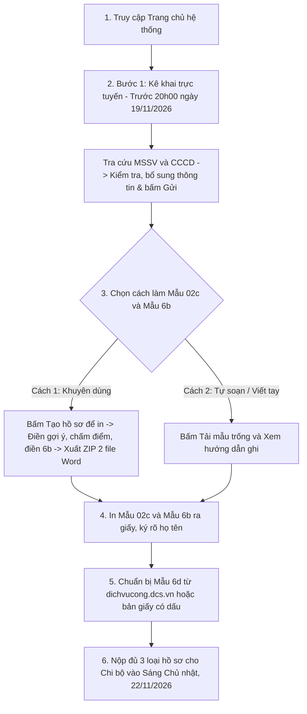

# HƯỚNG DẪN SỬ DỤNG HỆ THỐNG HỖ TRỢ KIỂM ĐIỂM, ĐÁNH GIÁ VÀ XẾP LOẠI ĐẢNG VIÊN NĂM 2026
**Đơn vị:** Chi bộ Sinh viên 1  
**Địa chỉ truy cập hệ thống:** https://diendue48k.github.io/KIEMDIEM2026_CBSV1/

---

## TÓM TẮT CÁC MỐC THỜI GIAN QUAN TRỌNG

| Mốc công việc | Địa chỉ thực hiện | Thời hạn hoàn thành |
|---|---|---|
| **Bước 1: Kê khai thông tin trực tuyến** (`kekhai.html`) | Trang chủ → **Thực hiện kê khai ngay** | Trước **20h00 - Thứ 5, ngày 19/11/2026** |
| **Bước 2: Tạo & in Mẫu 02c + Mẫu 6b** (`mau-02c.html`) | Trang chủ → **Tạo hồ sơ để in** *(hoặc tải mẫu trống)* | Hoàn thành trước buổi nộp hồ sơ |
| **Bước 3: Lấy Mẫu 6d & Nộp hồ sơ bản giấy** | [dichvucong.dcs.vn](https://dichvucong.dcs.vn) / Mẫu 6d giấy | **Sáng Chủ nhật, ngày 22/11/2026** |

---

## PHẦN 1: MẪU TIN NHẮN THÔNG BÁO NHANH (DÀNH CHO CHI ỦY GỬI NHÓM ZALO / MESSENGER)

```text
[CHI BỘ SINH VIÊN 1] THÔNG BÁO KÊ KHAI VÀ LÀM HỒ SƠ KIỂM ĐIỂM, ĐÁNH GIÁ ĐẢNG VIÊN NĂM 2026

Kính gửi các đồng chí Đảng viên Chi bộ Sinh viên 1,
Đề nghị các đồng chí truy cập Hệ thống hỗ trợ kiểm điểm, đánh giá và xếp loại Đảng viên năm 2026 tại đường dẫn:
👉 https://diendue48k.github.io/KIEMDIEM2026_CBSV1/

Các đồng chí thực hiện đầy đủ theo 3 bước trên hệ thống:
1️⃣ BƯỚC 1 - Kê khai trực tuyến ("Thực hiện kê khai ngay"):
   • Tra cứu bằng MSSV và CCCD; kiểm tra lại thông tin Chi bộ nơi cư trú & nơi ở hiện nay.
   • Nhập điểm học tập, rèn luyện năm học 2025 - 2026 (Khóa 52K nhập "0").
   • Mục 3.1: chỉ kê khai tối đa 04 thành tích cao nhất, nổi bật nhất.
   • HẠN CUỐI KÊ KHAI TRỰC TUYẾN: Trước 20h00 - Thứ 5, ngày 19/11/2026.

2️⃣ BƯỚC 2 - Tạo và xuất biểu mẫu để in ("Tạo hồ sơ để in"):
   • Sau khi kê khai xong Bước 1, hệ thống tự đổ dữ liệu sang Mẫu 02c và Mẫu 6b.
   • Chỉnh sửa, tự chấm điểm (theo Phụ lục 04) và bấm xuất tệp ZIP gồm 2 file Word (Mẫu 02c + Mẫu 6b) để in và ký tên.
   (Đảng viên kết nạp chưa đủ 6 tháng tính đến 21/11/2026 được miễn tự chấm điểm/xếp loại, chỉ thực hiện kê khai và xuất bản kiểm điểm).

3️⃣ BƯỚC 3 - Lấy Mẫu 6d (Nhận xét nơi cư trú) và nộp hồ sơ bản cứng:
   • Tải bản điện tử trên https://dichvucong.dcs.vn (nếu chưa có bản điện tử cần liên hệ ngay Bí thư Chi bộ nơi cư trú theo hướng dẫn trên trang chủ).
   • HẠN NỘP ĐẦY ĐỦ HỒ SƠ CHO CHI BỘ: Sáng Chủ nhật, ngày 22/11/2026.

Trân trọng!
```

---

## PHẦN 2: SƠ ĐỒ QUY TRÌNH THỰC HIỆN



---

## PHẦN 3: HƯỚNG DẪN CHI TIẾT TỪNG BƯỚC CHO ĐẢNG VIÊN

### Bước 1: Kê khai thông tin trực tuyến (`kekhai.html`)
> **Hạn cuối hoàn thành Bước 1:** Trước **20h00 - Thứ 5, ngày 19/11/2026**.  
> Hãy thực hiện Bước 1 trước để dữ liệu của đồng chí được ghi nhận lên hệ thống Chi bộ và **tự động đổ sang Bước 2**.

1. **Truy cập và tra cứu thông tin:**
   - Tại trang chủ, bấm nút **"Thực hiện kê khai ngay"**.
   - Nhập chính xác **Mã số sinh viên (MSSV)** và **Số CCCD**, sau đó bấm **"Kiểm tra & Tải thông tin"**.
   - Kiểm tra phần **Thông tin Đảng viên** (Họ tên, Ngày sinh, Ngày vào Đảng, Nhóm, Khoa/Trung tâm, Loại Đảng viên). Nếu thấy sai lệch, báo ngay cho Chi ủy để hiệu chỉnh trong danh sách gốc.

2. **Mục 1 — Thông tin sinh hoạt chi bộ nơi cư trú:**
   - Hệ thống sẽ tự động điền sẵn **Chi bộ Sinh hoạt nơi cư trú** và **Nơi ở hiện nay** từ dữ liệu hiện có (nếu trước đó đã khai báo).
   - Đồng chí cần **kiểm tra kỹ lại từng chữ** cho đúng với nơi đã đăng ký sinh hoạt theo Giấy 221 / Giấy 213 hiện tại; nếu còn trống hoặc chưa đúng thì gõ sửa lại theo gợi ý ví dụ trên ô nhập liệu.

3. **Mục 2 — Kết quả học tập - rèn luyện (Năm học 2025 – 2026):**
   - Nhập **Kết quả học tập** (thang điểm 4, ví dụ `3.50`) và **Kết quả rèn luyện** (ví dụ `85`) cho cả Học kì 1 và Học kì 2 của **năm học 2025 – 2026**.
   - **Lưu ý riêng đối với Đảng viên Khóa 52K:** Nhập số **`0`** vào cả 4 ô kết quả học tập và rèn luyện.

4. **Mục 3 — Thành tích và đóng góp:**
   - **Mục 3.1 (Thành tích đã đạt được):**
     - Chỉ kê khai **tối đa 04 loại thành tích cao nhất, nổi bật nhất** trong năm học 2025 – 2026 đến thời điểm hiện tại.
     - Điền đủ 4 cột (`Loại`, `Đơn vị cấp`, `Thời gian cấp`, `Tên thành tích`). Nhấn **`+ Thêm thành tích`** để thêm dòng; khi đạt tối đa **4/4 dòng**, nút thêm sẽ tự ẩn. Nếu không có thành tích, có thể để trống hoàn toàn dòng đầu tiên.
   - **Mục 3.2 (Đóng góp cho Chi bộ):**
     - Bắt buộc liệt kê tối thiểu 01 hoạt động đã tham gia/đóng góp cho Chi bộ Sinh viên và Chi bộ Sinh viên 1 trong năm học 2025 – 2026 (điền đủ 3 cột: *Hoạt động*, *Thời gian*, *Các nội dung đã đóng góp*). Nhấn **`+ Thêm hoạt động đóng góp`** nếu muốn khai thêm.

5. **Mục 4 & Phần III — Đề xuất ý kiến và Tự đánh giá xếp loại năm 2026:**
   - Nhập đề xuất, ý kiến đóng góp xây dựng Chi bộ và Nhà trường (nếu có).
   - Chọn **Tự xếp loại mức hoàn thành nhiệm vụ năm 2026** dựa trên kết quả **năm học 2025 - 2026**:
     - **Hoàn thành xuất sắc nhiệm vụ:** Điểm trung bình học tập **năm học 2025 - 2026** đạt từ loại **Giỏi** trở lên, rèn luyện từ loại **Tốt** trở lên.
     - **Hoàn thành tốt nhiệm vụ:** Điểm trung bình học tập **năm học 2025 - 2026** đạt từ loại **Khá** trở lên, rèn luyện từ loại **Tốt** trở lên.
   - **Trường hợp mới kết nạp:** Nếu Đảng viên kết nạp **chưa đủ 6 tháng tính đến ngày 21/11/2026** (ngày vào Đảng sau `21/05/2026`), hệ thống sẽ tự động hiện cảnh báo và **ẩn phần chọn xếp loại** (đồng chí chỉ gửi thông tin kê khai và làm bản kiểm điểm hồ sơ).
   - Tích chọn **cam đoan** và nhấn **"Gửi Thông Tin Kê Khai"**.

---

### Bước 2: Tạo và tải bộ biểu mẫu để in (`mau-02c.html`)

Tại trang chủ, trong **Phần 2**, đồng chí chọn **1 trong 2 cách**:

#### Cách 1: Khuyên dùng — Điền trực tuyến và xuất 2 file Word cùng lúc
1. Bấm nút **"Tạo hồ sơ để in"** trên trang chủ (hoặc bấm liên kết chuyển tiếp ngay sau khi gửi thành công Bước 1).
2. Hệ thống tự nhận diện phiên đăng nhập từ Bước 1 (hoặc đồng chí nhập lại MSSV + CCCD rồi bấm tra cứu). Các thông tin cá nhân, địa chỉ cư trú, điểm số, thành tích, đóng góp và tự xếp loại đã kê khai ở Bước 1 sẽ **tự động đổ sang biểu mẫu**.
3. **Phần A — Nội dung tự kiểm điểm (Mẫu 02c):**
   - Kiểm tra/bổ sung các mục từ `I.1` đến `VI`.
   - Có thể bấm nút **"Chèn gợi ý"** ở đầu mỗi ô để lấy đoạn văn mẫu chuẩn của Chi bộ, sau đó chỉnh sửa lại cho đúng với bản thân.
4. **Phần B — Nội dung tự đánh giá, chấm điểm & xếp loại:**
   - Bấm **"Xem Phụ lục 04 chấm điểm"** ở góc phải thẻ để đối chiếu khung tiêu chí chấm điểm đối với Đảng viên là sinh viên (Biểu số 32 Quy định 345-QĐ/TU).
   - Nhập **`1. Tiêu chí chung`** (tối đa `30` điểm) và **`2. Kết quả thực hiện NV`** (tối đa `70` điểm); hệ thống tự cộng tổng điểm `/100`.
   - Chọn mức đề xuất xếp loại phù hợp với tổng điểm và điều kiện năm học `2025 - 2026`. *(Đảng viên kết nạp chưa đủ 6 tháng tính đến `21/11/2026` sẽ được tự động ẩn phần chấm điểm và xếp loại).*
5. **Phần C — Phiếu bổ sung hồ sơ Đảng viên (Mẫu 6b):**
   - **Quy tắc chung:** Chỉ điền những mục **có thay đổi so với năm trước**; các mục không thay đổi giữ nguyên chữ **`K`**.
   - **Lưu ý riêng Khóa 52K:**
     - Mục *Mới thay đổi nơi ở*: nếu đang ở trọ thì ghi rõ địa chỉ trọ hiện nay.
     - Mục *Mới thay đổi về nghề nghiệp; đơn vị công tác*: ghi **`Sinh viên - Khoa [Tên khoa]`**.
   - Nhấn vào mục mở rộng *"Các mục khác..."* nếu có thay đổi về chức vụ, trình độ, khen thưởng từ bằng khen trở lên, kỷ luật, gia đình hoặc kinh tế.
6. **Xuất file & In ký tên:**
   - Bấm nút **"Xuất tệp ZIP hồ sơ để in (Mẫu 02c + Mẫu 6b)"**.
   - Giải nén file `.zip` vừa tải về, mở kiểm tra lại 2 file Word (`Mẫu 02c` và `Mẫu 6b`), in ra giấy A4 và ký ghi rõ họ tên.

#### Cách 2: Tải mẫu trống về viết tay hoặc tự soạn
- Trên trang chủ, bấm **"Tải mẫu trống"** để tải bộ biểu mẫu gốc và bấm **"Xem hướng dẫn ghi"** để đọc quy cách viết tay/đánh máy đúng chuẩn Chi bộ.

---

### Bước 3: Chuẩn bị Mẫu 6d (Nhận xét nơi cư trú) & Nộp hồ sơ

1. **Lấy Mẫu 6d (Nhận xét nơi cư trú):**
   - **Bản online (ưu tiên):** Truy cập Cổng Dịch vụ công Đảng tại [dichvucong.dcs.vn](https://dichvucong.dcs.vn) → Đăng nhập → Chọn **Thủ tục hành chính của tôi** → Bấm vào dòng **Lấy ý kiến nhận xét của Chi ủy chi bộ đối với đảng viên sinh hoạt nơi cư trú** → **Chi tiết giấy tờ** → Bấm biểu tượng tải xuống và in ra.
   - **Nếu chưa có bản điện tử:** Phải **liên hệ ngay Bí thư Chi bộ nơi cư trú** để xử lý kịp thời theo 3 trường hợp:
     - *Trường hợp 1:* Chi bộ nơi cư trú báo sẽ làm bản điện tử → hỏi rõ thời điểm trả kết quả để kịp tải và nộp trong tuần.
     - *Trường hợp 2:* Chi bộ nơi cư trú báo làm bản giấy theo mẫu 2-QĐ 221 → tải ngay mẫu giấy 6d (`Mau_6d_Nhan_xet_noi_cu_tru_2026.doc`) trên trang chủ, điền thông tin và xin ký xác nhận/đóng dấu.
     - *Trường hợp 3:* Chưa nộp Giấy 221 và chưa có bản điện tử → khẩn trương liên hệ Bí thư Chi bộ nơi cư trú để xin sinh hoạt 221 trước và nhờ cấp nhận xét kịp tiến độ.

2. **Kiểm tra đủ 3 loại hồ sơ bản giấy trước khi nộp vào `Sáng Chủ nhật, ngày 22/11/2026`:**
   - [ ] **01 Bản kiểm điểm cá nhân năm 2026 (Mẫu 02c)** — đã in và ký ghi rõ họ tên.
   - [ ] **01 Phiếu bổ sung hồ sơ Đảng viên năm 2026 (Mẫu 6b)** — đã in và ký ghi rõ họ tên.
   - [ ] **01 Phiếu nhận xét của Chi ủy nơi cư trú (Mẫu 6d)** — bản điện tử in từ `dichvucong.dcs.vn` hoặc bản giấy theo mẫu 2-QĐ 221 có xác nhận của Chi ủy nơi cư trú.

---

## PHẦN 4: GIẢI ĐÁP THẮC MẮC THƯỜNG GẶP (FAQ)

- **1. Nhập MSSV và CCCD nhưng hệ thống báo không tìm thấy?**  
  Kiểm tra lại có gõ dư khoảng trắng hoặc nhầm số CCCD/mã giảng viên (VD: `GVSV1`) hay không. Nếu vẫn không tra cứu được, liên hệ Chi ủy để kiểm tra và cập nhật vào danh sách trên Cổng Quản trị.
- **2. Đã gửi Bước 1 nhưng muốn sửa lại thông tin thì làm sao?**  
  Truy cập lại mục **Thực hiện kê khai ngay**, nhập lại đúng MSSV và CCCD. Hệ thống sẽ tự động tải lại toàn bộ nội dung đã gửi trước đó để đồng chí chỉnh sửa và bấm **"Cập Nhật Thông Tin Bổ Sung"** (lưu ý: hoàn tất trước **20h00 - Thứ 5, ngày 19/11/2026**).
- **3. Tại sao nút `+ Thêm thành tích` biến mất sau khi thêm 4 dòng?**  
  Theo quy định của Chi bộ, mục `3.1` chỉ kê khai **tối đa 04 thành tích cao nhất, nổi bật nhất**. Khi đã đủ 4 dòng, hệ thống ẩn nút thêm; nếu muốn thay thành tích khác, đồng chí sửa trực tiếp trên 4 dòng hiện có hoặc bấm `×` xóa bớt dòng không cần thiết.
- **4. Nên mở file `.zip` xuất ra từ Bước 2 trên thiết bị nào?**  
  Khuyên dùng **máy tính (Windows/macOS)** để bấm **"Xuất tệp ZIP hồ sơ để in (Mẫu 02c + Mẫu 6b)"**, sau đó giải nén file `.zip` bằng File Explorer / WinRAR / 7-Zip để mở bằng Microsoft Word kiểm tra bố cục trước khi in. Nếu dùng điện thoại, mở bằng ứng dụng *Tệp (Files)* để giải nén tệp `.zip`.
